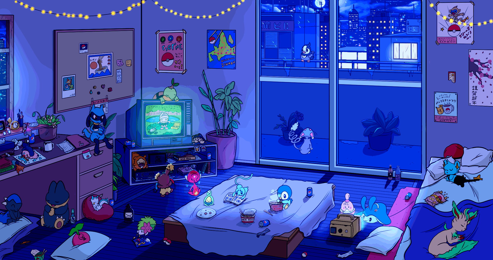

# Kevin Rajan

  

### Engineering for human flourishing

**Software should give imagination room to move.**

The best tools fade into the background when we're in flow, widening the horizon of what we can explore, create, and become.

I build at the intersection of engineering, intelligence, and human-centered design, creating tools that protect flow and expand the reach of human potential.

### Where I focus in open source

*My highest-attention collaborations, ordered by current focus. I contribute through implementation, reviews, testing, and experiments; proposed work is not necessarily merged.*

- **[Hermes](https://github.com/NousResearch/hermes-agent)**: agent runtime reliability, memory, native desktop UX, and Tern experiments.
- **[Oh My Pi](https://github.com/can1357/oh-my-pi)**: coding-agent ergonomics, TUI performance, context, and live/voice interaction.
- **[God's Eye View](https://github.com/bilawalsidhu/gods-eye-view)**: geospatial intelligence, disaster awareness, realtime controls, and attention-aware UX.
- **[CUA](https://github.com/trycua/cua)**: semantic computer use, native control, lower end-to-end latency, and verifiable execution.
- **[NOOP](https://github.com/ryanbr/noop)**: privacy-conscious wearable software, on-device data, and cross-platform experience. *Source-available under a noncommercial license.*
- **[Noctalia](https://github.com/noctalia-dev/noctalia)**: Linux desktop-shell polish, accessibility, layout, media, network, and interaction fixes.
- **[o8](https://github.com/hurttlocker/o8)**: multi-agent desktop workflows, responsive interfaces, Hermes integration, and mobile voice.

### Projects I'm building

**Intelligence and verifiable execution**

- **[z0intelligence](https://github.com/kvnloo/z0intelligence)**: evidence-backed context, routing, and bounded decisions for agents.
- **[AODL](https://github.com/kvnloo/aodl)**: a typed specification for agent orchestration · [explore](https://kvnloo.github.io/aodl/).
- **[z0evals](https://github.com/kvnloo/z0evals)**: reproducible evaluations and public research.
- **[Evolution Lab](https://github.com/kvnloo/evolution-lab)**: experiments and learning loops for improving agent systems.
- **[Kerdoios](https://github.com/kvnloo/kerdoios)**: compute placement, budget awareness, and routing experiments.
- **[bend-native](https://github.com/kvnloo/bend-native)**: proof-aware development tooling for Hermes and Bend.

**Engineering Reality**

- **[ACE](https://github.com/kvnloo/ace)**: a human-flourishing campus and digital-twin pretotype · [live site](https://kvnloo.github.io/ace/).
- **[OpenPaw](https://github.com/kvnloo/openpaw)**: an early, evidence-first approach to canine behavior and wellbeing.
- **[Elemental UI](https://github.com/kvnloo/elemental-ui)**: interface explorations.
- **[AudioEngine](https://github.com/kvnloo/AudioEngine)** *(2017)*: iOS realtime metering and a dual-channel 14-band EQ · [demo](https://kvnloo.github.io/AudioEngine/).

**Tools that protect flow**

- **[tmux-agent-fleet](https://github.com/kvnloo/tmux-agent-fleet)**: a fast, zero-daemon command palette for coding agents.
- **[z0live](https://github.com/kvnloo/z0live)**: realtime voice interaction experiments.
- **[.files](https://github.com/kvnloo/.files)**: my Linux workspace, terminal tooling, and audio DSP setup.

### More open-source work

*Grouped by depth of involvement, not repository popularity. These are links to the projects and communities themselves, not claims of ownership. Some contributions are still under review or developed downstream.*

**Recurring pull requests, reviews, and implementation**

- **Agent interfaces and workflows:** [T3Code](https://github.com/pingdotgg/t3code) · [Omarchy](https://github.com/omacom/omarchy) · [OpenMUSE](https://github.com/CopilotKit/openmuse) · [OpenClaw](https://github.com/openclaw/openclaw) · [CopilotKit](https://github.com/CopilotKit/CopilotKit) · [OpenBot](https://github.com/CopilotKit/OpenBot) · [oMaLauncher](https://github.com/SimonSchubert/omalauncher).
- **Compute and simulation:** [ROCm ATOM](https://github.com/ROCm/ATOM) · [Newton Physics](https://github.com/newton-physics/newton) · [OpenMC](https://github.com/openmc-dev/openmc) · [OpenUSD](https://github.com/PixarAnimationStudios/OpenUSD) · [OpenROAD](https://github.com/The-OpenROAD-Project/OpenROAD) · [NVIDIA OpenShell](https://github.com/NVIDIA/OpenShell).

**Focused patches, reviews, and downstream development**

- **Systems and performance:** [FX](https://github.com/vercel-labs/fx) · [objectKV](https://github.com/Doss-com/objectKV) · [Gazebo Sensors](https://github.com/gazebosim/gz-sensors) · [MCAP](https://github.com/foxglove/mcap) · [NVIDIA Container Toolkit](https://github.com/NVIDIA/nvidia-container-toolkit) · [SWR](https://github.com/vercel/swr).
- **Research and real-world applications:** [ActivityWatch](https://github.com/ActivityWatch/activitywatch) · [bluemira](https://github.com/Fusion-Power-Plant-Framework/bluemira) · [PyPSA](https://github.com/PyPSA/PyPSA) · [Open3D](https://github.com/isl-org/Open3D) · [CPlantBox](https://github.com/Plant-Root-Soil-Interactions-Modelling/CPlantBox).
- **Experience and developer tools:** [Noctalia legacy plugins](https://github.com/noctalia-dev/legacy-v4-plugins) · [agentsview](https://github.com/kenn-io/agentsview) · [goop](https://github.com/Trillient/goop).

**Exploration, research, and earlier-stage work**

- **Agent tooling:** [OpenCode](https://github.com/anomalyco/opencode) · [Crush](https://github.com/charmbracelet/crush) · [AG-UI](https://github.com/ag-ui-protocol/ag-ui) · [oh-my-openagent](https://github.com/code-yeongyu/oh-my-openagent) · [gstack](https://github.com/garrytan/gstack) · [AgentRun](https://github.com/Parcha-ai/agentrun).
- **Graphics, robotics, and spatial systems:** [NVIDIA Warp](https://github.com/NVIDIA/warp) · [MuJoCo Playground](https://github.com/google-deepmind/mujoco_playground) · [three.js](https://github.com/mrdoob/three.js) · [OpenSeadragon](https://github.com/openseadragon/openseadragon) · [Open-RMF](https://github.com/open-rmf/rmf_demos) · [NASA Trick](https://github.com/nasa/trick).
- **Infrastructure, energy, and tools:** [Kubernetes](https://github.com/kubernetes/kubernetes) · [Eclipse Ditto](https://github.com/eclipse-ditto/ditto) · [EnergyPlus](https://github.com/NatLabRockies/EnergyPlus) · [OpenModelica](https://github.com/OpenModelica/OpenModelica) · [napari](https://github.com/napari/napari) · [Immich](https://github.com/immich-app/immich).

---

**[Build log](https://kvnloo.github.io/boplog/)** · **[Portfolio](https://kvnloo.github.io/portfolio/)** · **[GitHub](https://github.com/kvnloo)**

I work in public where possible, often through small experiments, patches, and reviews. The maintainers and collaborators behind these projects deserve credit for the work they make possible. A fork, draft, or review is not an upstream merge.
